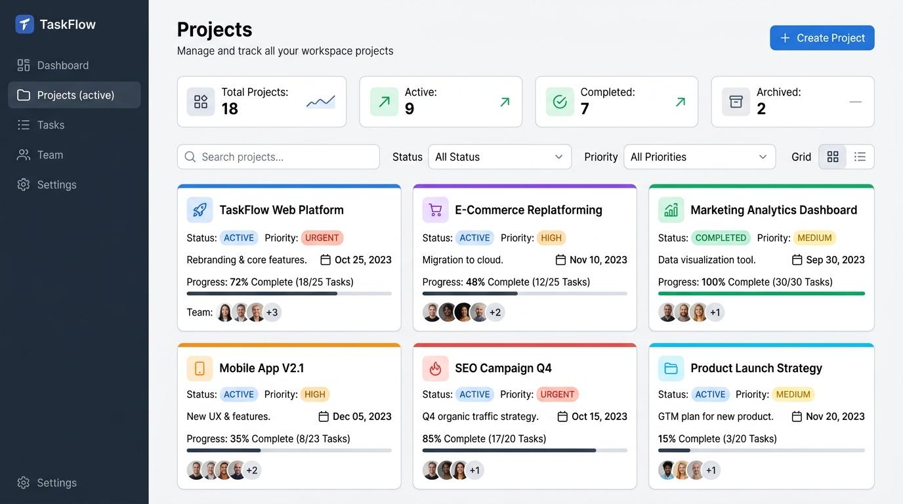
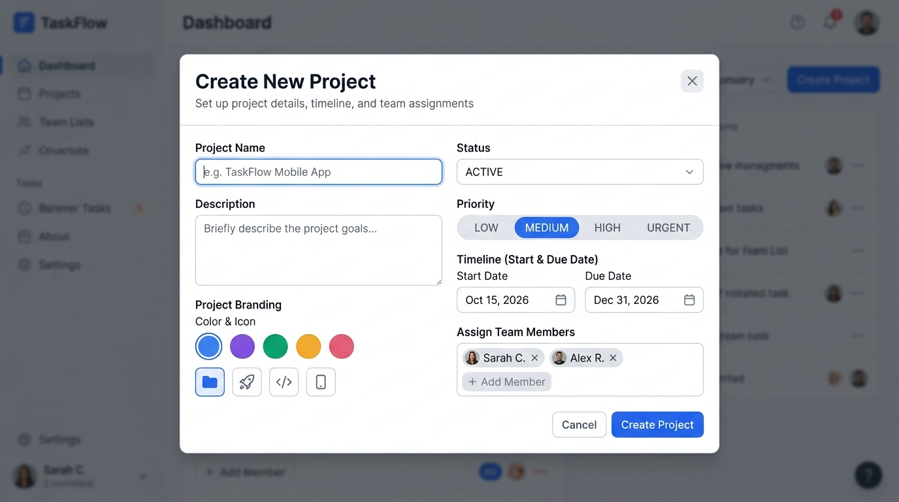
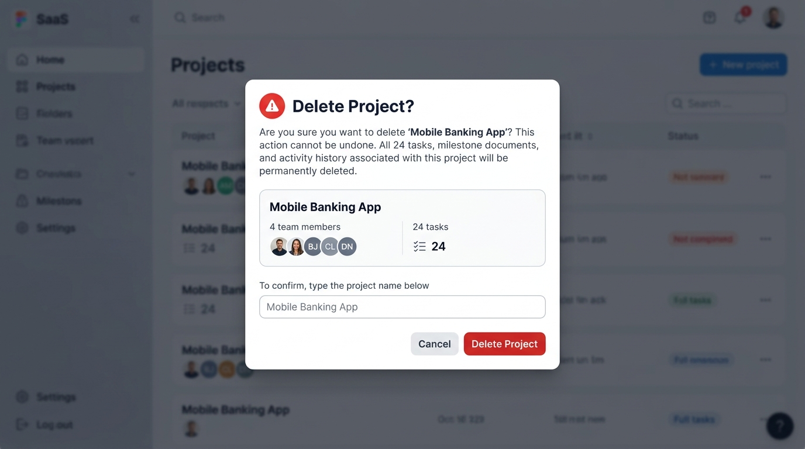
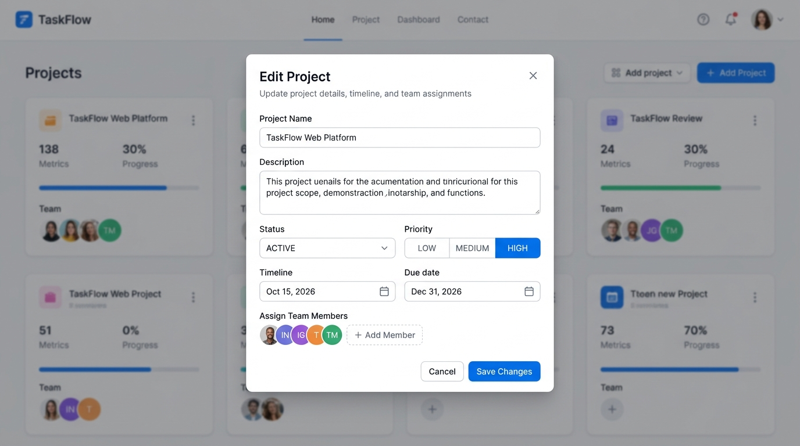

# TaskFlow Projects UI Designs

Here are the visual UI mockups for the Projects feature. You can open any image directly from the `docs/designs/` folder.

---

## 1. Projects Dashboard Page
File: [projects_page_design.jpg](./designs/projects_page_design.jpg)

---

## 2. Create Project Modal
File: [create_project_modal_design.jpg](./designs/create_project_modal_design.jpg)

---

## 3. Delete Project Confirmation Modal
File: [delete_project_modal_design.jpg](./designs/delete_project_modal_design.jpg)

---

## 4. Edit Project Modal
File: [edit_project_modal_design.jpg](./designs/edit_project_modal_design.jpg)

